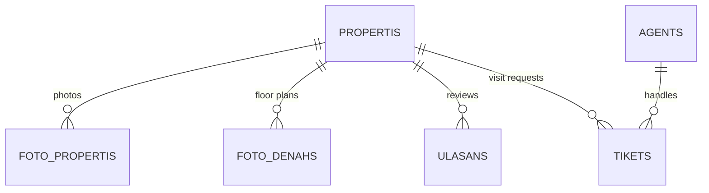

# KatalogWeb: Property E-Catalog

A web-based property e-catalog and admin panel for **PT. Duta Idaman Property**, built with **Laravel 10** and **MySQL** during my Web Developer internship (Jan – Aug 2024).

The e-catalog is part of the company's Real Estate Management Information System. It serves as a single source of truth for housing data. Clients browse listings and request site visits online, and staff manage properties, agents, partners, and visit requests from one admin panel.


## Features

### Public catalog

- **Landing page** with featured listings, listing counts per property type (house, apartment, villa, hotel), agents, and partners.
- **Property listing** with a price range filter. Keyword search and the bedroom/bathroom filters are being fixed (see [Roadmap](#roadmap)).
- **Property detail** with a photo gallery, floor plans, facilities (AC, Wi-Fi, TV, refrigerator, gym, garage), sale or rent status, and a Google Maps location.
- **Site-visit request**: visitors send their name, email, phone, and a message. The system creates a ticket (`INVxxxxxx`) with status `pending`.
- **Reviews** on each property.
- About, Contact, and FAQ pages.

### Admin panel (login required)

- **Dashboard** with total properties, agents, and partners.
- **Property management**: create, edit, delete, mark as sold, set map coordinates, and manage photo and floor plan galleries for each property.
- **Partner and agent management**, with photo upload.
- **Ticket management**: assign an agent and a visit schedule. The ticket status changes to `penjadwalan` (scheduled).
- **Content and access**: FAQ, About page, and admin user accounts.

## Tech Stack

| Layer | Tools |
| --- | --- |
| Backend | Laravel 10, PHP 8.1–8.3, Eloquent ORM |
| Database | MySQL 8 |
| Frontend | Blade templates, Bootstrap, Toastr |
| Maps | Google Maps embed (from latitude and longitude) |

## Data Model



Other tables: `mitras` (partners), `faqs`, `abouts`, and `users` (admin accounts).

The code uses Indonesian domain terms:

| Term | Meaning |
| --- | --- |
| `properti` | property listing |
| `foto_denah` | floor plan image |
| `mitra` | business partner |
| `agen` / `agent` | sales agent |
| `tiket` | site-visit request |
| `ulasan` | review |
| `terjual` | sold |

## Getting Started

### Requirements

- PHP 8.1–8.3 with the `pdo_mysql` extension
- Composer
- MySQL 8

### Setup

```bash
git clone https://github.com/Zen1710/KatalogWeb.git
cd KatalogWeb
composer install
cp .env.example .env
php artisan key:generate
```

Set the database in `.env`:

```env
DB_DATABASE=ekatalog
DB_USERNAME=root
DB_PASSWORD=
```

Create the database and import the sample data:

```bash
mysql -u root -e "CREATE DATABASE ekatalog CHARACTER SET utf8mb4 COLLATE utf8mb4_unicode_ci"
mysql -u root ekatalog < ekatalog.sql
```

To start with an empty database instead, run `php artisan migrate`.

### Run

```bash
php artisan serve
```

- Public catalog: http://127.0.0.1:8000
- Admin panel: http://127.0.0.1:8000/login (sample account `admin@gmail.com` / `123`, for local use only)

> The sample data in `ekatalog.sql` is dummy data. Some sample photos are not included in the repository, so a few images appear empty on a fresh clone.

## Project Structure

```
app/Http/Controllers/
  LandingPageController.php   public pages, filters, reviews
  PropertiController.php      property CRUD and sold status
  FotoPropertiController.php  property photo gallery
  FotoDenahController.php     floor plan gallery
  TiketController.php         site-visit requests and scheduling
  AgentController.php, MitraController.php, FaqController.php,
  AboutController.php, UserController.php, AuthController.php
resources/views/
  page/        public catalog pages
  admin/       admin panel pages
  theme/       layouts (user and admin)
public/images/ uploaded photos and facility icons
ekatalog.sql   database dump with sample data
```

## Roadmap

Planned improvements, worked on in the `develop` branch:

- [ ] Fix keyword search and the bedroom/bathroom filters, move filtering into the database query, and add pagination.
- [ ] Validate uploaded files (images only, size limit) and use one upload helper for every module.
- [ ] Replace GET delete links with `DELETE` requests protected by CSRF tokens.
- [ ] Harden login: rate limiting, session regeneration, and a single generic error message.
- [ ] Add validation and rate limiting to the public review and ticket forms.
- [ ] Add foreign keys so related photos, reviews, and tickets are removed with their property.

## Third-Party Licenses

- Public site template: [Property](https://untree.co/) by Untree.co, licensed under [CC BY 3.0](https://creativecommons.org/licenses/by/3.0/).
- Admin template: ArFa, MIT License (see [`public/arfa/LICENSE`](public/arfa/LICENSE)).
